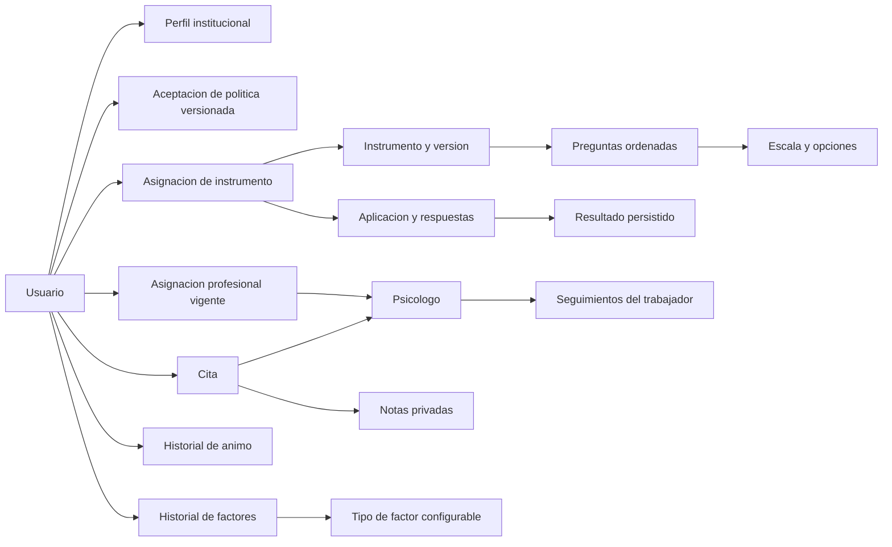

# T13 · Modelo conceptual del dominio

Revisión técnica: 16/10/2026. Alcance funcional: tareas hasta T37, con límite 19/10/2026. Fuente: hojas ReglasNegocio, RolesPermisos, CasosUso y Cronograma de SASPELCronograma3.xlsx. Este documento describe conceptos y contratos independientes de Django, SQL, HTTP y Angular.

**Estado de aceptación:** modelo conceptual aprobado por el responsable del desarrollo del proyecto SASPEL mediante declaración explícita en esta conversación el 16/10/2026. El diseño revisado permanece independiente de Django ORM. La aprobación satisface el criterio literal de T13 y permite cerrar la tarea; no se atribuye aprobación a terceros ni se presenta como una validación histórica previa a las tablas ya existentes.

**Evidencia de aprobación:** Cronograma!G14 establece: «Modelo conceptual del dominio aprobado, independiente de Django ORM.» No designa docente, cliente, psicólogo ni otra autoridad externa. El responsable declaró: «Yo, como responsable del desarrollo del proyecto SASPEL, apruebo el modelo conceptual contenido en: docs/T13_MODELO_DOMINIO.md». La aprobación corresponde al modelo publicado originalmente en 1e32168; este ajuste documenta su aceptación sin alterar el diseño conceptual.

## Entidades, identidad y límites de consistencia

Una entidad conserva su identidad aunque cambien sus atributos; un objeto de valor se compara por su contenido y se reemplaza completo. Los identificadores de entidades propias son UUID opacos. Las relaciones se expresan mediante identificadores; no requieren referencias a objetos del framework.

| Conjunto | Entidades y responsabilidad | Identidad / consistencia |
| --- | --- | --- |
| Identidad y acceso | Usuario representa la cuenta; Perfil contiene datos personales/institucionales. RolFuncional decide las capacidades, no la identidad. | UsuarioId y PerfilId; una cuenta tiene como máximo un perfil. Cambiar rol no crea una cuenta nueva. |
| Consentimiento | Política es una versión de un documento institucional. Aceptación relaciona una cuenta con una versión y la fecha aceptada. | PoliticaId, AceptacionId; aceptar una versión anterior no sustituye una versión obligatoria nueva. |
| Organización | Área, Cargo y relación ÁreaCargo definen la estructura permitida del perfil. | Identidades propias; activar/desactivar no destruye referencias históricas. |
| Asignación profesional | AsignacionProfesional vincula trabajador y psicólogo durante un intervalo de vigencia. | AsignacionId; como máximo una ACTIVA por trabajador. Reasignar finaliza la anterior y crea otra. |
| Configuración de evaluación | InstrumentoVersion reúne preguntas ordenadas y rangos de interpretación. Escala contiene opciones con valores; puede ser compartida por preguntas. | InstrumentoId; código/versión identifica la configuración. PreguntaId, EscalaId, OpcionId y RangoId conservan trazabilidad. |
| Aplicación | AsignacionInstrumento autoriza una aplicación a un trabajador; Aplicacion contiene respuestas y el resultado final. | AsignacionInstrumentoId, AplicacionId, RespuestaId y ResultadoId; finalizar es una operación atómica e idempotente. |
| Agenda | Disponibilidad define bloques semanales de un psicólogo. Cita relaciona participantes, intervalo y estado; puede referenciar una cita origen. | DisponibilidadId, CitaId; confirmar vuelve a comprobar disponibilidad, asignación y ausencia de solapamiento. |
| Atención profesional | NotaCita conserva una observación y su autor en una cita realizada. Seguimiento conserva una observación, estado y evolución en el tiempo. | NotaId y SeguimientoId; se agregan entradas y no se sobrescribe el historial publicado. |
| Bienestar personal | EstadoAnimo y FactorPsicosocial son registros propios fechados. TipoFactor define el catálogo institucional configurable. | AnimoId, FactorId, TipoFactorId; desactivar el tipo no invalida registros anteriores. |

## Objetos de valor

| Objeto | Contenido y regla |
| --- | --- |
| RolFuncional | NUEVO_TRABAJADOR, TRABAJADOR, PSICOLOGO, ADMIN o SUPERADMIN; la cuenta activa se reevalúa en cada operación sensible. |
| CorreoInstitucional | Correo normalizado y dominio institucional admitido; no equivale a un identificador de entidad. |
| IntervaloCita | Inicio y fin con zona horaria, fin posterior a inicio. Nuevas solicitudes y confirmaciones son futuras. Intervalos semiabiertos: una cita que empieza cuando termina otra no se solapa. |
| BloqueSemanal | Día de semana y horas de inicio/fin. La disponibilidad institucional usa la zona de Bolivia; las pantallas pueden mostrar la zona del dispositivo. |
| RespuestaEvaluacion | PreguntaId y OpcionId admitida, o valor según tipo; valida pertenencia a la configuración, obligatoriedad y completitud. |
| ItemPuntaje | Tipo, inversión, valor elegido y valores válidos de la escala; cálculo decimal explícito y reproducible. |
| RangoPuntaje | Límite inferior/superior y RangoId; seleccionar un rango no genera un diagnóstico. |
| ObservacionProfesional | Texto no vacío, hasta 10000 caracteres; contenido privado. |
| DatosSeguimiento | Motivo, categoría, observación, estado, evolución, plan de acción y próxima revisión opcional. La próxima revisión no puede registrarse en el pasado. Estado y evolución son descripciones profesionales, no diagnósticos automáticos. |
| DatosAnimo | Estado e intensidad expresados por el trabajador, comentario opcional. No hay una escala clínica implícita ni conversión a puntuaciones. |
| DatosFactor | TipoFactorId, nivel descriptivo y contexto laboral. El nombre del tipo se conserva al registrar para mantener el significado histórico. |
| SelloAuditoria | Actor creador/modificador y fechas de creación/modificación; el cliente no puede sustituir los valores derivados de la sesión. |

Los contratos inmutables de nota, seguimiento, ánimo y factor están expresados como dataclasses congeladas. Aunque se encuentran bajo el paquete `domain/entities`, representan objetos de valor de entrada, no entidades persistentes. El resto del modelo conceptual puede implementarse mediante servicios y contratos; no exige una clase ORM ni una clase duplicada por cada concepto.

## Relaciones conceptuales

## Invariantes y transiciones

1. **Acceso:** una cuenta nueva inicia en NUEVO_TRABAJADOR. Cambio de contraseña y políticas preceden a funciones protegidas. La finalización válida de la evaluación inicial cambia el rol a TRABAJADOR sin reemplazar la identidad (RN-USR-01/03, RN-PRI-02/03).
2. **Asignación:** elegir profesional activo y habilitado por menor carga, desempate por antigüedad sin asignación y criterio determinista. Si no existe candidato, conservar estado pendiente. No crear dos asignaciones activas (RN-ASG-01/07). El canal de notificaciones es alcance posterior, no una entidad implementada aquí.
3. **Instrumentos:** solo configuraciones activas permiten nuevas asignaciones; cada pregunta conserva orden y una escala compatible. Finalizar guarda respuestas, resultado y transición de onboarding en una misma operación. Un resultado consultado no se recalcula (RN-INS-01/08).
4. **Citas:** SOLICITADA → CONFIRMADA o RECHAZADA; SOLICITADA/CONFIRMADA → CANCELADA; CONFIRMADA → COMPLETADA por su profesional después del fin previsto. Rechazo/cancelación requieren motivo. El modelo admite REPROGRAMADA y referencia a origen; T31 no exige implementar el flujo completo de reprogramación. El historial no se borra (RN-CIT-01/05).
5. **Notas:** solo el psicólogo de la cita y actualmente asignado puede añadir o consultar notas. Para escribir, la cita debe estar COMPLETADA. Ni el trabajador ni los roles administrativos acceden al contenido (RN-CIT-04, RN-USR-05/06).
6. **Seguimiento:** solo el profesional con asignación activa registra o consulta; el historial incluye fecha, autor, motivo/categoría, observación, estado y evolución. Un nuevo seguimiento conserva los anteriores. El plan descriptivo requerido en RF-34 no implementa el módulo de recomendaciones de T48 (RN-SEG-01/03).
7. **Bienestar:** el trabajador registra y consulta únicamente sus datos; su profesional activo puede consultarlos. El catálogo no concede acceso a los registros. Los factores solo se registran contra tipos activos (RN-SEG-04, RN-PRI-01).
8. **Concurrencia:** autorización y lectura/escritura sensible comparten el límite transaccional de asignaciones. Una reasignación no puede intercalarse entre verificar permisos y acceder a información. Confirmaciones simultáneas de citas no pueden reservar el mismo horario.
9. **Historia:** desactivar, cerrar o reasignar conserva registros, relaciones y autoría. Auditoría mínima persistida mediante UUID, fechas, actores y marca deleted; no se afirma disponer todavía de un registro universal de eventos administrativos futuro.

## Casos de uso y puertos principales

| Caso de uso | Entrada → salida | Puerto de salida |
| --- | --- | --- |
| Autenticar / consultar identidad | Credencial o sesión → identidad vigente y capacidades | AuthProvider |
| Completar primer acceso | Contraseña/políticas → estado de acceso | PrimerAccesoRepository |
| Asignar profesional | Trabajador y motivo → asignación vigente e historial | AssignmentRepository |
| Administrar instrumentos | Configuración válida → instrumento/preguntas/escalas/rangos | InstrumentRepository / InstrumentContentRepository |
| Responder evaluación | Asignación y respuestas → aplicación/resultado y transición de rol | ResponderEvaluacionRepository |
| Consultar resultados | Actor y objeto solicitado → resultado autorizado persistido | ResultadosRepository |
| Gestionar citas | Actor, intervalo/acción → cita y estado | CitasRepository |
| Gestionar notas | Actor, cita completada, observación → nota fechada | NotasCitaRepository |
| Gestionar seguimiento | Actor, trabajador, DatosSeguimiento → entrada cronológica | SeguimientoRepository |
| Gestionar ánimo | Actor, DatosAnimo → registro propio; consulta profesional autorizada | EstadoAnimoRepository |
| Gestionar factores | Actor, DatosFactor o tipo de catálogo → registro o catálogo | FactoresRepository |

Application coordina permisos, transacción y reglas. Los adaptadores implementan los puertos y traducen errores a HTTP. Ninguna regla conceptual depende de un serializer, un componente de pantalla ni un modelo Django.

## Revisión y límites

Revisión cruzada: RN-USR, RN-ASG, RN-INS, RN-CIT, RN-SEG y RN-PRI del Excel; CU-17/20 y criterios T29, T31, T34/37. Los tests de arquitectura comprueban que Domain y Application no importan Django, DRF, Infrastructure ni mecanismos de transporte/almacenamiento.

Evidencia ejecutable: `test_architecture`, `test_cierre_onboarding`, `test_assignments_api`, `test_citas_api`, `test_notas_cita`, `test_seguimiento`, `test_estado_animo`, `test_factores` y `test_resultados_historial`. El modelo lógico y la correspondencia física se entregan separadamente en T14.

Fuera de esta entrega: alertas, notificaciones, recomendaciones estructuradas, tendencias, reportes, predicción e IA. No se presupone su implementación por aparecer como conceptos futuros en el cronograma. La falta de línea base histórica T08 no altera estas invariantes ni se resuelve con el esquema actual.
