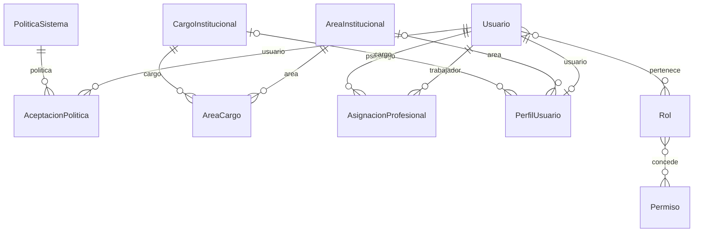
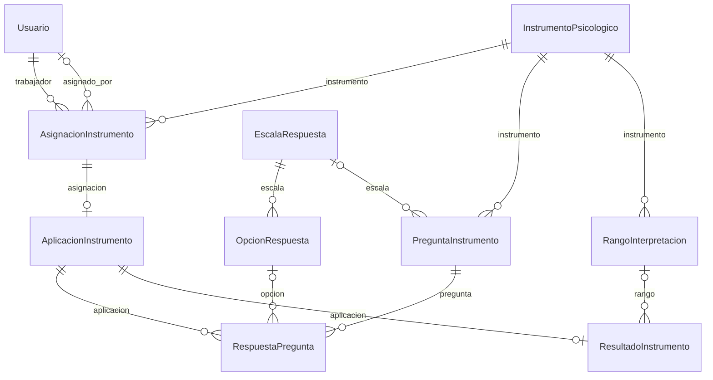
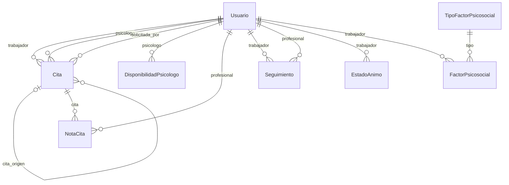

# T14 · DER lógico y diccionario de datos

Revisado el 16/10/2026 contra el modelo conceptual T13, las reglas del Excel y la implementación integrada hasta T37. La aprobación funcional de T13 sigue sin evidencia; este trabajo revisa consistencia y trazabilidad técnica y no sustituye esa aprobación. No certifica que las tablas se hayan creado después del diseño original.

## DER lógico

Cardinalidades: cada hijo referencia un padre obligatorio (||) u opcional (|o); un padre puede tener cero o muchos hijos (o{), o cero o uno (o|). Roles y permisos técnicos de Django complementan estas entidades.

### Identidad y organización

### Instrumentos y resultados

### Agenda, atención y bienestar

## Diccionario común

Todos los modelos propios tienen los siguientes campos. NULL se refiere a almacenamiento; un texto no nulo puede admitir cadena vacía y el caso de uso puede exigir más condiciones. Las claves foráneas a entidades propias son UUID.

| Atributo | Columna | Tipo | Significado |
| --- | --- | --- | --- |
| id | id | UUID, PK | Identidad inmutable. |
| creado_en | Time_Create | Fecha/hora, no nulo | Instante de creación. |
| actualizado_en | Time_Update | Fecha/hora, no nulo | Última modificación persistida. |
| creado_por | User_Create | Texto(150), no nulo | Actor creador; contexto de sesión o SYSTEM para procesos. |
| actualizado_por | User_Update | Texto(150), no nulo | Actor de última modificación. |
| deleted | deleted | Booleano, no nulo | Marca lógica; no habilita borrado físico desde API. |

Las fechas/hora se manejan con zona horaria. Una fecha civil (DateField) no representa un instante UTC. Los nombres de tablas se incluyen únicamente como correspondencia con el esquema vigente.

### Usuario

Cuenta e identidad estable; los grupos representan roles funcionales. Tabla: `saspel_usuario`.

| Atributo / columna | Tipo / dominio | NULL | Clave / significado |
| --- | --- | --- | --- |
| password | Texto(128) | No | Hash de contraseña; nunca contraseña en claro ni salida de API. |
| last_login | Fecha/hora | Sí | Último acceso registrado. |
| is_superuser | Booleano | No | Privilegio técnico Django; no concede acceso funcional a notas privadas. |
| username | Texto(150) | No | Único. Identificador de acceso institucional. |
| first_name | Texto(150) | No | Nombres. |
| last_name | Texto(150) | No | Apellido paterno. |
| email | Texto(254) | No | Correo institucional. |
| is_staff | Booleano | No | Acceso técnico al sitio administrativo Django. |
| is_active | Booleano | No | Cuenta habilitada para iniciar sesión. |
| date_joined | Fecha/hora | No | Fecha de alta técnica. |
| debe_cambiar_password | Booleano | No | Obliga al cambio de contraseña inicial. |

Relaciones muchos a muchos: groups → Group; user_permissions → Permission.

### PoliticaSistema

Documento institucional versionado y vigencia. Tabla: `saspel_politica_sistema`.

| Atributo / columna | Tipo / dominio | NULL | Clave / significado |
| --- | --- | --- | --- |
| tipo | Texto(30); TERMINOS_USO, PRIVACIDAD_DATOS, CONSENTIMIENTO_EVALUACION | No | Categoría o referencia de tipo. |
| titulo | Texto(200) | No | Título del documento. |
| version | Texto(50) | No | Versión de configuración o documento. |
| contenido | Texto | No | Contenido institucional versionado. |
| vigente_desde | Fecha/hora | No | Inicio de vigencia. |
| obligatoria | Booleano | No | Requiere aceptación o respuesta según el contexto. |
| activo | Booleano | No | Habilitado para nuevas operaciones. |

Restricciones persistidas:
- `<UniqueConstraint: fields=('tipo', 'version') name='politica_tipo_version_unica'>`
- `<UniqueConstraint: fields=('tipo',) name='politica_tipo_activo_unico' condition=(AND: ('activo', True))>`
- `<CheckConstraint: condition=(AND: ('tipo__in', ['TERMINOS_USO', 'PRIVACIDAD_DATOS', 'CONSENTIMIENTO_EVALUACION'])) name='politica_tipo_valido'>`
- `<CheckConstraint: condition=(NOT (AND: ('activo', True), ('deleted', True))) name='politica_activa_no_deleted'>`

### AceptacionPolitica

Aceptación individual de una versión concreta. Tabla: `saspel_aceptacion_politica`.

| Atributo / columna | Tipo / dominio | NULL | Clave / significado |
| --- | --- | --- | --- |
| usuario / usuario_id | UUID | No | FK → Usuario. PROTECT. Relación usuario. |
| politica / politica_id | UUID | No | FK → PoliticaSistema. PROTECT. Relación politica. |
| fecha_aceptacion | Fecha/hora | No | Instante de aceptación. |

Restricciones persistidas:
- `<UniqueConstraint: fields=('usuario', 'politica') name='aceptacion_usuario_politica_unica'>`

### InstrumentoPsicologico

Configuración de un instrumento identificado por código y versión. Tabla: `saspel_instrumento_psicologico`.

| Atributo / columna | Tipo / dominio | NULL | Clave / significado |
| --- | --- | --- | --- |
| codigo | Texto(50) | No | Código del instrumento. |
| nombre | Texto(200) | No | Nombre visible. |
| version | Texto(50) | No | Versión de configuración o documento. |
| descripcion | Texto | No | Descripción del registro o configuración. |
| instrucciones | Texto | No | Instrucciones de aplicación. |
| es_inicial | Booleano | No | Instrumento de onboarding. |
| activo | Booleano | No | Habilitado para nuevas operaciones. |

Restricciones persistidas:
- `<UniqueConstraint: fields=('es_inicial',) name='saspel_unico_instrumento_inicial_activo' condition=(AND: ('activo', True), ('es_inicial', True))>`
- `<UniqueConstraint: fields=('codigo', 'version') name='saspel_instrumento_codigo_version_unico'>`

### AsignacionInstrumento

Autorización de un instrumento para un trabajador. Tabla: `saspel_asignacion_instrumento`.

| Atributo / columna | Tipo / dominio | NULL | Clave / significado |
| --- | --- | --- | --- |
| trabajador / trabajador_id | UUID | No | FK → Usuario. PROTECT. Relación trabajador. |
| instrumento / instrumento_id | UUID | No | FK → InstrumentoPsicologico. PROTECT. Relación instrumento. |
| asignado_por / asignado_por_id | UUID | Sí | FK → Usuario. PROTECT. Relación asignado por. |
| origen | Texto(11); SISTEMA, PROFESIONAL | No | Origen de la asignación. |
| estado | Texto(11); PENDIENTE, EN_PROGRESO, COMPLETADA, CANCELADA | No | Estado operativo o descripción personal/profesional según entidad. |
| fecha_asignacion | Fecha/hora | No | Inicio de la asignación. |
| fecha_limite | Fecha/hora | Sí | Límite opcional de respuesta. |

Restricciones persistidas:
- `<CheckConstraint: condition=(AND: ('origen__in', ['SISTEMA', 'PROFESIONAL'])) name='saspel_asig_instrumento_origen_valido'>`
- `<CheckConstraint: condition=(AND: ('estado__in', ['PENDIENTE', 'EN_PROGRESO', 'COMPLETADA', 'CANCELADA'])) name='saspel_asig_instrumento_estado_valido'>`

### AplicacionInstrumento

Ejecución única de una asignación. Tabla: `saspel_aplicacion_instrumento`.

| Atributo / columna | Tipo / dominio | NULL | Clave / significado |
| --- | --- | --- | --- |
| asignacion / asignacion_id | UUID | No | Único. FK → AsignacionInstrumento. PROTECT. Relación asignacion. |
| estado | Texto(10); INICIADA, FINALIZADA, ANULADA | No | Estado operativo o descripción personal/profesional según entidad. |
| fecha_inicio | Fecha/hora | Sí | Inicio de cita o aplicación. |
| fecha_finalizacion | Fecha/hora | Sí | Finalización efectiva de la aplicación. |

Restricciones persistidas:
- `<CheckConstraint: condition=(AND: ('estado__in', ['INICIADA', 'FINALIZADA', 'ANULADA'])) name='saspel_aplicacion_estado_valido'>`

### AreaInstitucional

Catálogo de áreas. Tabla: `saspel_area_institucional`.

| Atributo / columna | Tipo / dominio | NULL | Clave / significado |
| --- | --- | --- | --- |
| nombre | Texto(150) | No | Único. Nombre visible. |
| descripcion | Texto | No | Descripción del registro o configuración. |
| activo | Booleano | No | Habilitado para nuevas operaciones. |

### CargoInstitucional

Catálogo de cargos. Tabla: `saspel_cargo_institucional`.

| Atributo / columna | Tipo / dominio | NULL | Clave / significado |
| --- | --- | --- | --- |
| nombre | Texto(150) | No | Único. Nombre visible. |
| descripcion | Texto | No | Descripción del registro o configuración. |
| activo | Booleano | No | Habilitado para nuevas operaciones. |

### AreaCargo

Combinación permitida de área y cargo. Tabla: `saspel_area_cargo`.

| Atributo / columna | Tipo / dominio | NULL | Clave / significado |
| --- | --- | --- | --- |
| area / area_id | UUID | No | FK → AreaInstitucional. PROTECT. Relación area. |
| cargo / cargo_id | UUID | No | FK → CargoInstitucional. PROTECT. Relación cargo. |

Restricciones persistidas:
- `<UniqueConstraint: fields=('area', 'cargo') name='area_cargo_unico'>`

### AsignacionProfesional

Vínculo temporal trabajador–psicólogo. Tabla: `saspel_asignacion_profesional`.

| Atributo / columna | Tipo / dominio | NULL | Clave / significado |
| --- | --- | --- | --- |
| trabajador / trabajador_id | UUID | No | FK → Usuario. PROTECT. Relación trabajador. |
| psicologo / psicologo_id | UUID | No | FK → Usuario. PROTECT. Relación psicologo. |
| fecha_asignacion | Fecha/hora | No | Inicio de la asignación. |
| fecha_fin | Fecha/hora | Sí | Fin previsto de cita o cierre de asignación. |
| estado | Texto(10); ACTIVA, FINALIZADA, REASIGNADA | No | Estado operativo o descripción personal/profesional según entidad. |
| motivo_fin | Texto | No | Razón del cierre de asignación. |

Restricciones persistidas:
- `<CheckConstraint: condition=(NOT (AND: ('trabajador', F(psicologo)))) name='saspel_asignacion_usuarios_distintos'>`
- `<UniqueConstraint: fields=('trabajador',) name='saspel_una_asignacion_activa_por_trabajador' condition=(AND: ('estado', 'ACTIVA'))>`
- `<CheckConstraint: condition=(AND: ('estado__in', ['ACTIVA', 'FINALIZADA', 'REASIGNADA'])) name='saspel_asignacion_estado_valido'>`

### Cita

Solicitud y atención de un trabajador por un psicólogo. Tabla: `saspel_cita`.

| Atributo / columna | Tipo / dominio | NULL | Clave / significado |
| --- | --- | --- | --- |
| trabajador / trabajador_id | UUID | No | FK → Usuario. PROTECT. Relación trabajador. |
| psicologo / psicologo_id | UUID | No | FK → Usuario. PROTECT. Relación psicologo. |
| solicitada_por / solicitada_por_id | UUID | No | FK → Usuario. PROTECT. Relación solicitada por. |
| fecha_inicio | Fecha/hora | No | Inicio de cita o aplicación. |
| fecha_fin | Fecha/hora | No | Fin previsto de cita o cierre de asignación. |
| motivo | Texto | No | Motivo de atención o solicitud. |
| prioridad | Texto(5); BAJA, MEDIA, ALTA | No | Prioridad elegida de la cita. |
| estado | Texto(12); SOLICITADA, CONFIRMADA, COMPLETADA, CANCELADA, RECHAZADA, REPROGRAMADA | No | Estado operativo o descripción personal/profesional según entidad. |
| motivo_cierre | Texto | No | Motivo de cancelación/rechazo; no es una nota clínica. |
| cita_origen / cita_origen_id | UUID | Sí | FK → Cita. PROTECT. Cita anterior conservada para reprogramación. |

Restricciones persistidas:
- `<CheckConstraint: condition=(AND: ('fecha_inicio__lt', F(fecha_fin))) name='saspel_cita_fechas_validas'>`
- `<CheckConstraint: condition=(NOT (AND: ('trabajador', F(psicologo)))) name='saspel_cita_usuarios_distintos'>`
- `<CheckConstraint: condition=(OR: ('cita_origen__isnull', True), (NOT (AND: ('cita_origen', F(pk))))) name='saspel_cita_origen_distinto'>`
- `<CheckConstraint: condition=(AND: ('estado__in', ['SOLICITADA', 'CONFIRMADA', 'COMPLETADA', 'CANCELADA', 'RECHAZADA', 'REPROGRAMADA'])) name='saspel_cita_estado_valido'>`
- `<CheckConstraint: condition=(AND: ('prioridad__in', ['BAJA', 'MEDIA', 'ALTA'])) name='saspel_cita_prioridad_valida'>`

Índices de consulta: psicologo + fecha_inicio + estado; trabajador + fecha_inicio + estado.

### DisponibilidadPsicologo

Bloque semanal habilitado para citas. Tabla: `saspel_disponibilidad_psicologo`.

| Atributo / columna | Tipo / dominio | NULL | Clave / significado |
| --- | --- | --- | --- |
| psicologo / psicologo_id | UUID | No | FK → Usuario. PROTECT. Relación psicologo. |
| dia_semana | Entero no negativo; 0, 1, 2, 3, 4, 5, 6 | No | 0 lunes a 6 domingo. |
| hora_inicio | Hora | No | Hora inicial en la zona institucional. |
| hora_fin | Hora | No | Hora final en la zona institucional. |
| activo | Booleano | No | Habilitado para nuevas operaciones. |

Restricciones persistidas:
- `<CheckConstraint: condition=(AND: ('hora_inicio__lt', F(hora_fin))) name='saspel_disponibilidad_horas_validas'>`
- `<CheckConstraint: condition=(AND: ('dia_semana__gte', 0), ('dia_semana__lte', 6)) name='saspel_disponibilidad_dia_valido'>`
- `<UniqueConstraint: fields=('psicologo', 'dia_semana', 'hora_inicio', 'hora_fin') name='saspel_disponibilidad_bloque_unico'>`

Índices de consulta: psicologo + dia_semana + activo.

### EscalaRespuesta

Escala compartible entre preguntas. Tabla: `saspel_escala_respuesta`.

| Atributo / columna | Tipo / dominio | NULL | Clave / significado |
| --- | --- | --- | --- |
| nombre | Texto(150) | No | Único. Nombre visible. |
| descripcion | Texto | No | Descripción del registro o configuración. |
| activo | Booleano | No | Habilitado para nuevas operaciones. |

### OpcionRespuesta

Etiqueta y valor seleccionable dentro de una escala. Tabla: `saspel_opcion_respuesta`.

| Atributo / columna | Tipo / dominio | NULL | Clave / significado |
| --- | --- | --- | --- |
| escala / escala_id | UUID | No | FK → EscalaRespuesta. PROTECT. Relación escala. |
| etiqueta | Texto(150) | No | Texto visible de la opción. |
| valor | SmallIntegerField | No | Valor decimal de puntuación de la opción. |
| orden | Entero no negativo | No | Posición relativa dentro del conjunto. |
| activo | Booleano | No | Habilitado para nuevas operaciones. |

Restricciones persistidas:
- `<UniqueConstraint: fields=('escala', 'orden') name='saspel_opcion_escala_orden_unico'>`
- `<UniqueConstraint: fields=('escala', 'valor') name='saspel_opcion_escala_valor_unico'>`

### PerfilUsuario

Datos personales y ubicación institucional; estado del onboarding y elegibilidad profesional. Tabla: `saspel_perfil_usuario`.

| Atributo / columna | Tipo / dominio | NULL | Clave / significado |
| --- | --- | --- | --- |
| usuario / usuario_id | UUID | No | Único. FK → Usuario. CASCADE. Relación usuario. |
| codigo_empleado | Texto(50) | No | Único. Identificador institucional del perfil. |
| apellido_materno | Texto(150) | No | Apellido materno. |
| fecha_nacimiento | Fecha | Sí | Fecha de nacimiento. |
| sexo | Texto(1); F, M, O | No | Valor de sexo registrado. |
| telefono | Texto(30) | No | Teléfono de contacto. |
| area / area_id | UUID | Sí | FK → AreaInstitucional. PROTECT. Relación area. |
| cargo / cargo_id | UUID | Sí | FK → CargoInstitucional. PROTECT. Relación cargo. |
| tamizaje_resuelto | Booleano | No | Evaluación inicial completada. |
| habilitado_asignaciones | Booleano | No | Profesional disponible para nuevas asignaciones. |

### PreguntaInstrumento

Pregunta ordenada, tipo y escala compatible. Tabla: `saspel_pregunta_instrumento`.

| Atributo / columna | Tipo / dominio | NULL | Clave / significado |
| --- | --- | --- | --- |
| instrumento / instrumento_id | UUID | No | FK → InstrumentoPsicologico. PROTECT. Relación instrumento. |
| texto | Texto | No | Enunciado de pregunta. |
| orden | Entero no negativo | No | Posición relativa dentro del conjunto. |
| tipo_respuesta | Texto(8); ESCALA, TEXTO, NUMERO, BOOLEANO | No | Tipo de dato esperado. |
| escala / escala_id | UUID | Sí | FK → EscalaRespuesta. PROTECT. Relación escala. |
| invertida | Booleano | No | Invierte el aporte según los extremos de la escala. |
| obligatoria | Booleano | No | Requiere aceptación o respuesta según el contexto. |
| activo | Booleano | No | Habilitado para nuevas operaciones. |

Restricciones persistidas:
- `<UniqueConstraint: fields=('instrumento', 'orden') name='saspel_pregunta_instrumento_orden_unico'>`
- `<CheckConstraint: condition=(AND: ('tipo_respuesta__in', ['ESCALA', 'TEXTO', 'NUMERO', 'BOOLEANO'])) name='saspel_pregunta_tipo_valido'>`

### RangoInterpretacion

Intervalo e interpretación configurada; no implica diagnóstico. Tabla: `saspel_rango_interpretacion`.

| Atributo / columna | Tipo / dominio | NULL | Clave / significado |
| --- | --- | --- | --- |
| instrumento / instrumento_id | UUID | No | FK → InstrumentoPsicologico. PROTECT. Relación instrumento. |
| nombre | Texto(150) | No | Nombre visible. |
| puntaje_minimo | IntegerField | No | Límite inferior inclusivo. |
| puntaje_maximo | IntegerField | No | Límite superior inclusivo. |
| interpretacion | Texto | No | Interpretación configurada del rango. |
| orden | Entero no negativo | No | Posición relativa dentro del conjunto. |
| activo | Booleano | No | Habilitado para nuevas operaciones. |

Restricciones persistidas:
- `<CheckConstraint: condition=(AND: ('puntaje_minimo__lte', F(puntaje_maximo))) name='saspel_rango_limites_validos'>`
- `<UniqueConstraint: fields=('instrumento', 'nombre') name='saspel_rango_instrumento_nombre_unico'>`
- `<UniqueConstraint: fields=('instrumento', 'orden') name='saspel_rango_instrumento_orden_unico'>`

### RespuestaPregunta

Respuesta individual a una pregunta en una aplicación. Tabla: `saspel_respuesta_pregunta`.

| Atributo / columna | Tipo / dominio | NULL | Clave / significado |
| --- | --- | --- | --- |
| aplicacion / aplicacion_id | UUID | No | FK → AplicacionInstrumento. PROTECT. Relación aplicacion. |
| pregunta / pregunta_id | UUID | No | FK → PreguntaInstrumento. PROTECT. Relación pregunta. |
| opcion / opcion_id | UUID | Sí | FK → OpcionRespuesta. PROTECT. Relación opcion. |
| valor_texto | Texto | Sí | Respuesta de tipo texto. |
| valor_numerico | Decimal(12,4) | Sí | Respuesta numérica. |
| valor_booleano | Booleano | Sí | Respuesta booleana. |

Restricciones persistidas:
- `<UniqueConstraint: fields=('aplicacion', 'pregunta') name='saspel_respuesta_aplicacion_pregunta_unica'>`

### ResultadoInstrumento

Puntaje y rango persistidos de una aplicación finalizada. Tabla: `saspel_resultado_instrumento`.

| Atributo / columna | Tipo / dominio | NULL | Clave / significado |
| --- | --- | --- | --- |
| aplicacion / aplicacion_id | UUID | No | Único. FK → AplicacionInstrumento. PROTECT. Relación aplicacion. |
| puntaje_total | Decimal(12,4) | No | Puntaje calculado persistido. |
| rango / rango_id | UUID | Sí | FK → RangoInterpretacion. PROTECT. Relación rango. |
| fecha_calculo | Fecha/hora | No | Instante de cálculo. |

### NotaCita

Observación privada de una cita realizada. Tabla: `saspel_nota_cita`.

| Atributo / columna | Tipo / dominio | NULL | Clave / significado |
| --- | --- | --- | --- |
| cita / cita_id | UUID | No | FK → Cita. PROTECT. Relación cita. |
| profesional / profesional_id | UUID | No | FK → Usuario. PROTECT. Relación profesional. |
| observacion | Texto(10000) | No | Observación profesional privada. |

### Seguimiento

Entrada profesional fechada con estado, evolución y plan descriptivo. Tabla: `saspel_seguimiento`.

| Atributo / columna | Tipo / dominio | NULL | Clave / significado |
| --- | --- | --- | --- |
| trabajador / trabajador_id | UUID | No | FK → Usuario. PROTECT. Relación trabajador. |
| profesional / profesional_id | UUID | No | FK → Usuario. PROTECT. Relación profesional. |
| motivo | Texto(500) | No | Motivo de atención o solicitud. |
| categoria | Texto(100) | No | Categoría descriptiva del seguimiento. |
| observacion | Texto(10000) | No | Observación profesional privada. |
| estado | Texto(100) | No | Estado operativo o descripción personal/profesional según entidad. |
| evolucion | Texto(5000) | No | Evolución descrita por el profesional. |
| plan_accion | Texto(5000) | No | Plan descriptivo del seguimiento; sin módulo de recomendaciones T48. |
| proxima_revision | Fecha | Sí | Fecha opcional de siguiente revisión. |

Índices de consulta: trabajador + creado_en.

### EstadoAnimo

Registro personal de ánimo e intensidad descriptiva. Tabla: `saspel_estado_animo`.

| Atributo / columna | Tipo / dominio | NULL | Clave / significado |
| --- | --- | --- | --- |
| trabajador / trabajador_id | UUID | No | FK → Usuario. PROTECT. Relación trabajador. |
| estado | Texto(100) | No | Estado operativo o descripción personal/profesional según entidad. |
| intensidad | Texto(100) | No | Intensidad expresada con palabras, sin escala clínica implícita. |
| comentario | Texto(3000) | No | Comentario personal opcional. |

Índices de consulta: trabajador + creado_en.

### TipoFactorPsicosocial

Catálogo institucional de factores configurables. Tabla: `saspel_tipo_factor_psicosocial`.

| Atributo / columna | Tipo / dominio | NULL | Clave / significado |
| --- | --- | --- | --- |
| nombre | Texto(120) | No | Único. Nombre visible. |
| descripcion | Texto(1000) | No | Descripción del registro o configuración. |
| activo | Booleano | No | Habilitado para nuevas operaciones. |

### FactorPsicosocial

Registro personal de tipo, nivel y contexto laboral. Tabla: `saspel_factor_psicosocial`.

| Atributo / columna | Tipo / dominio | NULL | Clave / significado |
| --- | --- | --- | --- |
| trabajador / trabajador_id | UUID | No | FK → Usuario. PROTECT. Relación trabajador. |
| tipo / tipo_id | UUID | No | FK → TipoFactorPsicosocial. PROTECT. Categoría o referencia de tipo. |
| tipo_nombre | Texto(120) | No | Nombre histórico del tipo al registrar. |
| nivel | Texto(100) | No | Nivel descriptivo expresado por el trabajador. |
| descripcion | Texto(3000) | No | Descripción del registro o configuración. |

Índices de consulta: trabajador + creado_en.

## Revisión contra reglas de negocio

| Regla | Decisión lógica / evidencia |
| --- | --- |
| RN-USR-01/06, RN-PRI-01 | Usuario y perfil separados; rol vigente más pertenencia/asignación autorizan datos sensibles. Privilegio administrativo no es una relación de atención. |
| RN-PRI-02/03 | Aceptación referencia la versión de política; unicidad usuario/política; política activa única por tipo. |
| RN-ASG-01/07 | Unicidad condicional de trabajador con asignación ACTIVA; reasignación conserva fila anterior. |
| RN-INS-01/08 | Código/versión único; orden único por instrumento/escala; aplicación única por asignación; respuesta única por aplicación/pregunta; resultado único por aplicación. Los casos de uso validan pertenencia y completitud. |
| RN-CIT-01/05 | Cita tiene participantes distintos, intervalo válido y origen distinto de sí misma; autorización y solapamientos se verifican bajo transacción compartida. Nota tiene FK protegida a cita y autor. |
| RN-SEG-01/04 | Seguimiento conserva trabajador, profesional y fecha; ánimo/factor pertenecen al trabajador; cada nueva entrada preserva las anteriores. |
| RN-DB-01 | Catálogos, perfiles, escalas, opciones, preguntas y registros se separan para evitar grupos repetidos y dependencias transitivas. Excepciones controladas descritas debajo. |

Normalización y excepciones: `FactorPsicosocial.tipo_nombre` es una copia histórica deliberada del nombre al registrar. No se sincroniza tras renombrar el catálogo, porque representa el hecho pasado; tipo_id mantiene la relación. ResultadoInstrumento guarda un cálculo derivado para trazabilidad e idempotencia y nunca se recalcula al consultar. Los actores de auditoría se guardan como texto conforme al esquema existente; profesional/trabajador tienen FK tipada adicional.

Las FK de negocio usan PROTECT salvo PerfilUsuario.usuario, que conserva el CASCADE histórico del framework. La API no expone eliminación física de usuarios; su desactivación conserva perfil y datos. No se modifica esa relación ni se ejecuta borrado en esta entrega. Las tablas técnicas auth, session, admin y migrations son infraestructura, no entidades clínicas; sus claves técnicas pueden ser enteras.

No toda regla vive en una restricción de BD: disponibilidad, permisos por asignación, identidad del autor, resultado final inmutable y catálogo activo se validan en casos de uso/adaptadores. El bloqueo compartido evita carreras entre autorización y cambios de asignación. No se afirma que una escritura SQL arbitraria tenga las mismas garantías que la API.

Validación: diccionario de 24 entidades propias y 135 atributos específicos contrastado con metadatos de los modelos; auditoría común descrita una vez. Migraciones revisadas hasta 0010, sin migraciones nuevas para esta documentación. Pruebas de arquitectura y modelos iniciales/instrumentos/citas, junto con notas/seguimiento/ánimo/factores, verifican restricciones y flujos. La inspección no lee ni publica registros personales.

Resultado ejecutado: 98/98 pruebas de arquitectura, modelos y auditoría UUID aprobadas. La fixture global de UUID se amplió de 19 a 24 entidades para cubrir las cinco añadidas en T34–T37, manteniendo las comprobaciones de claves, referencias, columnas y fechas de auditoría. makemigrations --check --dry-run: sin cambios pendientes.
