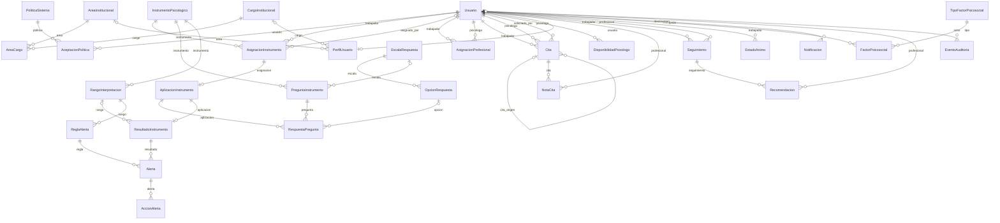

# Diccionario físico y relaciones H4

Esquema ORM hasta la migración 0016. Los nombres corresponden a columnas físicas. La prueba de catálogo contrasta estas definiciones con PostgreSQL.

## Relaciones

## saspel_usuario

| Columna | Tipo ORM | Nulo | Clave o relación |
|---|---|---|---|
| password | CharField | no |   |
| last_login | DateTimeField | sí |   |
| is_superuser | BooleanField | no |   |
| username | CharField | no | única  |
| first_name | CharField | no |   |
| last_name | CharField | no |   |
| email | CharField | no |   |
| is_staff | BooleanField | no |   |
| is_active | BooleanField | no |   |
| date_joined | DateTimeField | no |   |
| id | UUIDField | no | PK  |
| Time_Create | DateTimeField | no |   |
| Time_Update | DateTimeField | no |   |
| User_Create | CharField | no |   |
| User_Update | CharField | no |   |
| deleted | BooleanField | no |   |
| debe_cambiar_password | BooleanField | no |   |
| version_sesion | PositiveIntegerField | no |   |

## saspel_politica_sistema

| Columna | Tipo ORM | Nulo | Clave o relación |
|---|---|---|---|
| id | UUIDField | no | PK  |
| Time_Create | DateTimeField | no |   |
| Time_Update | DateTimeField | no |   |
| User_Create | CharField | no |   |
| User_Update | CharField | no |   |
| deleted | BooleanField | no |   |
| tipo | CharField | no |   |
| titulo | CharField | no |   |
| version | CharField | no |   |
| contenido | TextField | no |   |
| vigente_desde | DateTimeField | no |   |
| obligatoria | BooleanField | no |   |
| activo | BooleanField | no |   |

## saspel_aceptacion_politica

| Columna | Tipo ORM | Nulo | Clave o relación |
|---|---|---|---|
| id | UUIDField | no | PK  |
| Time_Create | DateTimeField | no |   |
| Time_Update | DateTimeField | no |   |
| User_Create | CharField | no |   |
| User_Update | CharField | no |   |
| deleted | BooleanField | no |   |
| usuario_id | ForeignKey | no |  → saspel_usuario.id (PROTECT) |
| politica_id | ForeignKey | no |  → saspel_politica_sistema.id (PROTECT) |
| fecha_aceptacion | DateTimeField | no |   |

## saspel_instrumento_psicologico

| Columna | Tipo ORM | Nulo | Clave o relación |
|---|---|---|---|
| id | UUIDField | no | PK  |
| Time_Create | DateTimeField | no |   |
| Time_Update | DateTimeField | no |   |
| User_Create | CharField | no |   |
| User_Update | CharField | no |   |
| deleted | BooleanField | no |   |
| codigo | CharField | no |   |
| nombre | CharField | no |   |
| version | CharField | no |   |
| descripcion | TextField | no |   |
| instrucciones | TextField | no |   |
| es_inicial | BooleanField | no |   |
| activo | BooleanField | no |   |

## saspel_asignacion_instrumento

| Columna | Tipo ORM | Nulo | Clave o relación |
|---|---|---|---|
| id | UUIDField | no | PK  |
| Time_Create | DateTimeField | no |   |
| Time_Update | DateTimeField | no |   |
| User_Create | CharField | no |   |
| User_Update | CharField | no |   |
| deleted | BooleanField | no |   |
| trabajador_id | ForeignKey | no |  → saspel_usuario.id (PROTECT) |
| instrumento_id | ForeignKey | no |  → saspel_instrumento_psicologico.id (PROTECT) |
| asignado_por_id | ForeignKey | sí |  → saspel_usuario.id (PROTECT) |
| origen | CharField | no |   |
| estado | CharField | no |   |
| fecha_asignacion | DateTimeField | no |   |
| fecha_limite | DateTimeField | sí |   |

## saspel_aplicacion_instrumento

| Columna | Tipo ORM | Nulo | Clave o relación |
|---|---|---|---|
| id | UUIDField | no | PK  |
| Time_Create | DateTimeField | no |   |
| Time_Update | DateTimeField | no |   |
| User_Create | CharField | no |   |
| User_Update | CharField | no |   |
| deleted | BooleanField | no |   |
| asignacion_id | OneToOneField | no | única → saspel_asignacion_instrumento.id (PROTECT) |
| estado | CharField | no |   |
| fecha_inicio | DateTimeField | sí |   |
| fecha_finalizacion | DateTimeField | sí |   |

## saspel_area_institucional

| Columna | Tipo ORM | Nulo | Clave o relación |
|---|---|---|---|
| id | UUIDField | no | PK  |
| Time_Create | DateTimeField | no |   |
| Time_Update | DateTimeField | no |   |
| User_Create | CharField | no |   |
| User_Update | CharField | no |   |
| deleted | BooleanField | no |   |
| nombre | CharField | no | única  |
| descripcion | TextField | no |   |
| activo | BooleanField | no |   |

## saspel_cargo_institucional

| Columna | Tipo ORM | Nulo | Clave o relación |
|---|---|---|---|
| id | UUIDField | no | PK  |
| Time_Create | DateTimeField | no |   |
| Time_Update | DateTimeField | no |   |
| User_Create | CharField | no |   |
| User_Update | CharField | no |   |
| deleted | BooleanField | no |   |
| nombre | CharField | no | única  |
| descripcion | TextField | no |   |
| activo | BooleanField | no |   |

## saspel_area_cargo

| Columna | Tipo ORM | Nulo | Clave o relación |
|---|---|---|---|
| id | UUIDField | no | PK  |
| Time_Create | DateTimeField | no |   |
| Time_Update | DateTimeField | no |   |
| User_Create | CharField | no |   |
| User_Update | CharField | no |   |
| deleted | BooleanField | no |   |
| area_id | ForeignKey | no |  → saspel_area_institucional.id (PROTECT) |
| cargo_id | ForeignKey | no |  → saspel_cargo_institucional.id (PROTECT) |

## saspel_asignacion_profesional

| Columna | Tipo ORM | Nulo | Clave o relación |
|---|---|---|---|
| id | UUIDField | no | PK  |
| Time_Create | DateTimeField | no |   |
| Time_Update | DateTimeField | no |   |
| User_Create | CharField | no |   |
| User_Update | CharField | no |   |
| deleted | BooleanField | no |   |
| trabajador_id | ForeignKey | no |  → saspel_usuario.id (PROTECT) |
| psicologo_id | ForeignKey | no |  → saspel_usuario.id (PROTECT) |
| fecha_asignacion | DateTimeField | no |   |
| fecha_fin | DateTimeField | sí |   |
| estado | CharField | no |   |
| motivo_fin | TextField | no |   |

## saspel_cita

| Columna | Tipo ORM | Nulo | Clave o relación |
|---|---|---|---|
| id | UUIDField | no | PK  |
| Time_Create | DateTimeField | no |   |
| Time_Update | DateTimeField | no |   |
| User_Create | CharField | no |   |
| User_Update | CharField | no |   |
| deleted | BooleanField | no |   |
| trabajador_id | ForeignKey | no |  → saspel_usuario.id (PROTECT) |
| psicologo_id | ForeignKey | no |  → saspel_usuario.id (PROTECT) |
| solicitada_por_id | ForeignKey | no |  → saspel_usuario.id (PROTECT) |
| fecha_inicio | DateTimeField | no |   |
| fecha_fin | DateTimeField | no |   |
| motivo | TextField | no |   |
| prioridad | CharField | no |   |
| estado | CharField | no |   |
| motivo_cierre | TextField | no |   |
| cita_origen_id | ForeignKey | sí |  → saspel_cita.id (PROTECT) |

## saspel_disponibilidad_psicologo

| Columna | Tipo ORM | Nulo | Clave o relación |
|---|---|---|---|
| id | UUIDField | no | PK  |
| Time_Create | DateTimeField | no |   |
| Time_Update | DateTimeField | no |   |
| User_Create | CharField | no |   |
| User_Update | CharField | no |   |
| deleted | BooleanField | no |   |
| psicologo_id | ForeignKey | no |  → saspel_usuario.id (PROTECT) |
| dia_semana | PositiveSmallIntegerField | no |   |
| hora_inicio | TimeField | no |   |
| hora_fin | TimeField | no |   |
| activo | BooleanField | no |   |

## saspel_escala_respuesta

| Columna | Tipo ORM | Nulo | Clave o relación |
|---|---|---|---|
| id | UUIDField | no | PK  |
| Time_Create | DateTimeField | no |   |
| Time_Update | DateTimeField | no |   |
| User_Create | CharField | no |   |
| User_Update | CharField | no |   |
| deleted | BooleanField | no |   |
| nombre | CharField | no | única  |
| descripcion | TextField | no |   |
| activo | BooleanField | no |   |

## saspel_opcion_respuesta

| Columna | Tipo ORM | Nulo | Clave o relación |
|---|---|---|---|
| id | UUIDField | no | PK  |
| Time_Create | DateTimeField | no |   |
| Time_Update | DateTimeField | no |   |
| User_Create | CharField | no |   |
| User_Update | CharField | no |   |
| deleted | BooleanField | no |   |
| escala_id | ForeignKey | no |  → saspel_escala_respuesta.id (PROTECT) |
| etiqueta | CharField | no |   |
| valor | SmallIntegerField | no |   |
| orden | PositiveSmallIntegerField | no |   |
| activo | BooleanField | no |   |

## saspel_perfil_usuario

| Columna | Tipo ORM | Nulo | Clave o relación |
|---|---|---|---|
| id | UUIDField | no | PK  |
| Time_Create | DateTimeField | no |   |
| Time_Update | DateTimeField | no |   |
| User_Create | CharField | no |   |
| User_Update | CharField | no |   |
| deleted | BooleanField | no |   |
| usuario_id | OneToOneField | no | única → saspel_usuario.id (CASCADE) |
| codigo_empleado | CharField | no | única  |
| apellido_materno | CharField | no |   |
| fecha_nacimiento | DateField | sí |   |
| sexo | CharField | no |   |
| telefono | CharField | no |   |
| area_id | ForeignKey | sí |  → saspel_area_institucional.id (PROTECT) |
| cargo_id | ForeignKey | sí |  → saspel_cargo_institucional.id (PROTECT) |
| tamizaje_resuelto | BooleanField | no |   |
| habilitado_asignaciones | BooleanField | no |   |

## saspel_pregunta_instrumento

| Columna | Tipo ORM | Nulo | Clave o relación |
|---|---|---|---|
| id | UUIDField | no | PK  |
| Time_Create | DateTimeField | no |   |
| Time_Update | DateTimeField | no |   |
| User_Create | CharField | no |   |
| User_Update | CharField | no |   |
| deleted | BooleanField | no |   |
| instrumento_id | ForeignKey | no |  → saspel_instrumento_psicologico.id (PROTECT) |
| texto | TextField | no |   |
| orden | PositiveSmallIntegerField | no |   |
| tipo_respuesta | CharField | no |   |
| escala_id | ForeignKey | sí |  → saspel_escala_respuesta.id (PROTECT) |
| invertida | BooleanField | no |   |
| obligatoria | BooleanField | no |   |
| activo | BooleanField | no |   |

## saspel_rango_interpretacion

| Columna | Tipo ORM | Nulo | Clave o relación |
|---|---|---|---|
| id | UUIDField | no | PK  |
| Time_Create | DateTimeField | no |   |
| Time_Update | DateTimeField | no |   |
| User_Create | CharField | no |   |
| User_Update | CharField | no |   |
| deleted | BooleanField | no |   |
| instrumento_id | ForeignKey | no |  → saspel_instrumento_psicologico.id (PROTECT) |
| nombre | CharField | no |   |
| puntaje_minimo | IntegerField | no |   |
| puntaje_maximo | IntegerField | no |   |
| interpretacion | TextField | no |   |
| orden | PositiveSmallIntegerField | no |   |
| activo | BooleanField | no |   |

## saspel_respuesta_pregunta

| Columna | Tipo ORM | Nulo | Clave o relación |
|---|---|---|---|
| id | UUIDField | no | PK  |
| Time_Create | DateTimeField | no |   |
| Time_Update | DateTimeField | no |   |
| User_Create | CharField | no |   |
| User_Update | CharField | no |   |
| deleted | BooleanField | no |   |
| aplicacion_id | ForeignKey | no |  → saspel_aplicacion_instrumento.id (PROTECT) |
| pregunta_id | ForeignKey | no |  → saspel_pregunta_instrumento.id (PROTECT) |
| opcion_id | ForeignKey | sí |  → saspel_opcion_respuesta.id (PROTECT) |
| valor_texto | TextField | sí |   |
| valor_numerico | DecimalField | sí |   |
| valor_booleano | BooleanField | sí |   |

## saspel_resultado_instrumento

| Columna | Tipo ORM | Nulo | Clave o relación |
|---|---|---|---|
| id | UUIDField | no | PK  |
| Time_Create | DateTimeField | no |   |
| Time_Update | DateTimeField | no |   |
| User_Create | CharField | no |   |
| User_Update | CharField | no |   |
| deleted | BooleanField | no |   |
| aplicacion_id | OneToOneField | no | única → saspel_aplicacion_instrumento.id (PROTECT) |
| puntaje_total | DecimalField | no |   |
| rango_id | ForeignKey | sí |  → saspel_rango_interpretacion.id (PROTECT) |
| fecha_calculo | DateTimeField | no |   |

## saspel_nota_cita

| Columna | Tipo ORM | Nulo | Clave o relación |
|---|---|---|---|
| id | UUIDField | no | PK  |
| Time_Create | DateTimeField | no |   |
| Time_Update | DateTimeField | no |   |
| User_Create | CharField | no |   |
| User_Update | CharField | no |   |
| deleted | BooleanField | no |   |
| cita_id | ForeignKey | no |  → saspel_cita.id (PROTECT) |
| profesional_id | ForeignKey | no |  → saspel_usuario.id (PROTECT) |
| observacion | TextField | no |   |

## saspel_seguimiento

| Columna | Tipo ORM | Nulo | Clave o relación |
|---|---|---|---|
| id | UUIDField | no | PK  |
| Time_Create | DateTimeField | no |   |
| Time_Update | DateTimeField | no |   |
| User_Create | CharField | no |   |
| User_Update | CharField | no |   |
| deleted | BooleanField | no |   |
| trabajador_id | ForeignKey | no |  → saspel_usuario.id (PROTECT) |
| profesional_id | ForeignKey | no |  → saspel_usuario.id (PROTECT) |
| motivo | CharField | no |   |
| categoria | CharField | no |   |
| observacion | TextField | no |   |
| estado | CharField | no |   |
| evolucion | TextField | no |   |
| plan_accion | TextField | no |   |
| proxima_revision | DateField | sí |   |

## saspel_estado_animo

| Columna | Tipo ORM | Nulo | Clave o relación |
|---|---|---|---|
| id | UUIDField | no | PK  |
| Time_Create | DateTimeField | no |   |
| Time_Update | DateTimeField | no |   |
| User_Create | CharField | no |   |
| User_Update | CharField | no |   |
| deleted | BooleanField | no |   |
| trabajador_id | ForeignKey | no |  → saspel_usuario.id (PROTECT) |
| estado | CharField | no |   |
| intensidad | CharField | no |   |
| comentario | TextField | no |   |

## saspel_tipo_factor_psicosocial

| Columna | Tipo ORM | Nulo | Clave o relación |
|---|---|---|---|
| id | UUIDField | no | PK  |
| Time_Create | DateTimeField | no |   |
| Time_Update | DateTimeField | no |   |
| User_Create | CharField | no |   |
| User_Update | CharField | no |   |
| deleted | BooleanField | no |   |
| nombre | CharField | no | única  |
| descripcion | TextField | no |   |
| activo | BooleanField | no |   |

## saspel_factor_psicosocial

| Columna | Tipo ORM | Nulo | Clave o relación |
|---|---|---|---|
| id | UUIDField | no | PK  |
| Time_Create | DateTimeField | no |   |
| Time_Update | DateTimeField | no |   |
| User_Create | CharField | no |   |
| User_Update | CharField | no |   |
| deleted | BooleanField | no |   |
| trabajador_id | ForeignKey | no |  → saspel_usuario.id (PROTECT) |
| tipo_id | ForeignKey | no |  → saspel_tipo_factor_psicosocial.id (PROTECT) |
| tipo_nombre | CharField | no |   |
| nivel | CharField | no |   |
| descripcion | TextField | no |   |

## saspel_regla_alerta

| Columna | Tipo ORM | Nulo | Clave o relación |
|---|---|---|---|
| id | UUIDField | no | PK  |
| Time_Create | DateTimeField | no |   |
| Time_Update | DateTimeField | no |   |
| User_Create | CharField | no |   |
| User_Update | CharField | no |   |
| deleted | BooleanField | no |   |
| nombre | CharField | no |   |
| rango_id | ForeignKey | no |  → saspel_rango_interpretacion.id (PROTECT) |
| nivel | CharField | no |   |
| activa | BooleanField | no |   |

## saspel_alerta

| Columna | Tipo ORM | Nulo | Clave o relación |
|---|---|---|---|
| id | UUIDField | no | PK  |
| Time_Create | DateTimeField | no |   |
| Time_Update | DateTimeField | no |   |
| User_Create | CharField | no |   |
| User_Update | CharField | no |   |
| deleted | BooleanField | no |   |
| regla_id | ForeignKey | no |  → saspel_regla_alerta.id (PROTECT) |
| resultado_id | ForeignKey | no |  → saspel_resultado_instrumento.id (PROTECT) |
| estado | CharField | no |   |

## saspel_accion_alerta

| Columna | Tipo ORM | Nulo | Clave o relación |
|---|---|---|---|
| id | UUIDField | no | PK  |
| Time_Create | DateTimeField | no |   |
| Time_Update | DateTimeField | no |   |
| User_Create | CharField | no |   |
| User_Update | CharField | no |   |
| deleted | BooleanField | no |   |
| alerta_id | ForeignKey | no |  → saspel_alerta.id (PROTECT) |
| estado | CharField | no |   |
| observacion | TextField | no |   |

## saspel_notificacion

| Columna | Tipo ORM | Nulo | Clave o relación |
|---|---|---|---|
| id | UUIDField | no | PK  |
| Time_Create | DateTimeField | no |   |
| Time_Update | DateTimeField | no |   |
| User_Create | CharField | no |   |
| User_Update | CharField | no |   |
| deleted | BooleanField | no |   |
| destinatario_id | ForeignKey | no |  → saspel_usuario.id (PROTECT) |
| tipo | CharField | no |   |
| titulo | CharField | no |   |
| origen_id | UUIDField | no |   |
| evento | CharField | no |   |
| leida_en | DateTimeField | sí |   |

## saspel_recomendacion

| Columna | Tipo ORM | Nulo | Clave o relación |
|---|---|---|---|
| id | UUIDField | no | PK  |
| Time_Create | DateTimeField | no |   |
| Time_Update | DateTimeField | no |   |
| User_Create | CharField | no |   |
| User_Update | CharField | no |   |
| deleted | BooleanField | no |   |
| compartida | BooleanField | no |   |
| seguimiento_id | ForeignKey | no |  → saspel_seguimiento.id (PROTECT) |
| profesional_id | ForeignKey | no |  → saspel_usuario.id (PROTECT) |
| texto | TextField | no |   |
| estado | CharField | no |   |

## saspel_evento_auditoria

| Columna | Tipo ORM | Nulo | Clave o relación |
|---|---|---|---|
| id | UUIDField | no | PK  |
| actor_id | ForeignKey | sí |  → saspel_usuario.id (PROTECT) |
| fecha | DateTimeField | no |   |
| accion | CharField | no |   |
| entidad | CharField | no |   |
| entidad_id | UUIDField | sí |   |
| estado | CharField | no |   |
